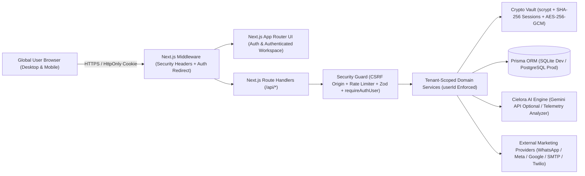
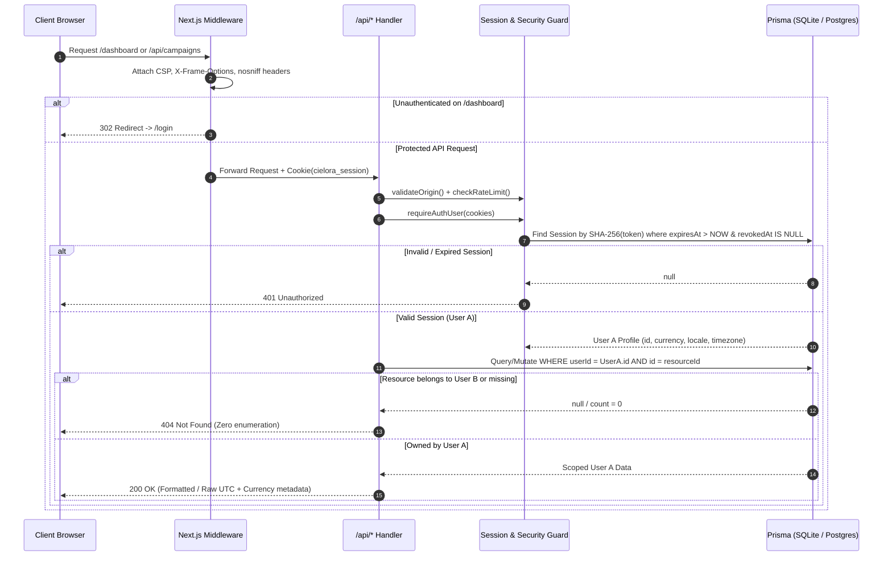
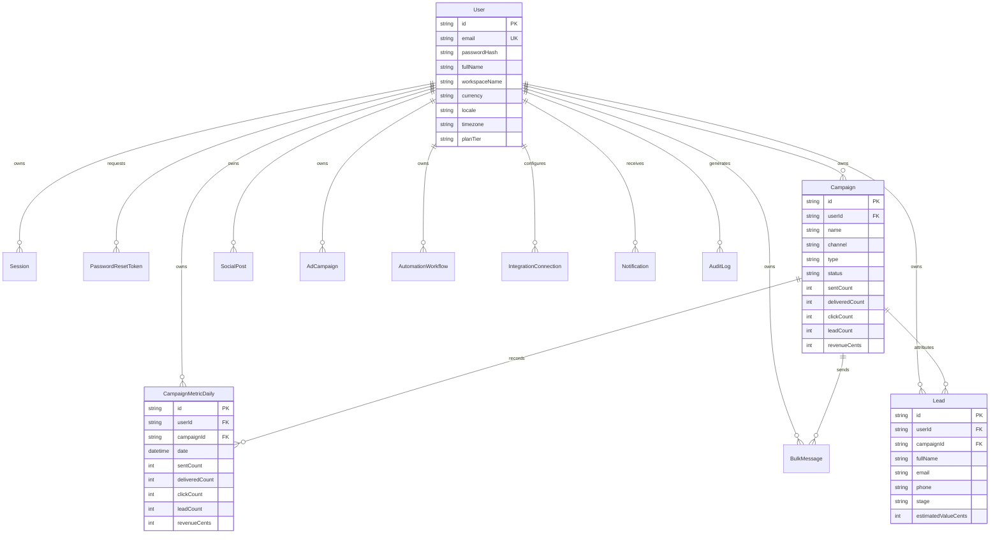

# Design & System Architecture — Cielora AI

**Document Version:** 1.0.0  
**Scope:** End-to-End System Topology, Data Model, Request Isolation, Global Localization & UI Design System  

---

## 1. High-Level System Architecture (C4 Container View)

---

## 2. Authentication & Strict User-Wise Isolation Flow

---

## 3. Entity Relationship Diagram (ERD)

---

## 4. UI / UX Design System Architecture (Aligned to Reference Mockups)

### 4.1 Brand & Color Palette
| Token | Hex / Gradient | Usage |
| :--- | :--- | :--- |
| **Sidebar Cosmic Deep** | `linear-gradient(180deg, #160C2E 0%, #100822 65%, #1E103D 100%)` | Persistent left navigation rail & hero dark canvas |
| **Primary Brand Accent** | `linear-gradient(135deg, #7C3AED 0%, #C026D3 55%, #EC4899 100%)` | Primary buttons (`Log In`, `Create Campaign`, `Ask Cielora AI`), brand highlights |
| **Active Sidebar Pill** | `linear-gradient(90deg, #EC4899 0%, #F472B6 50%, #F97316 100%)` | Active navigation state with soft magenta glow |
| **Upgrade Gold/Flame CTA** | `linear-gradient(90deg, #F59E0B 0%, #EC4899 100%)` | Bottom sidebar `Upgrade Now` action |
| **Auth Ambient Backdrop** | `radial-gradient(circle at 20% 20%, #F5F3FF, #EFF6FF 45%, #FDF2F8 100%)` | Luminous frosted login/signup canvas |
| **App Canvas Surface** | `#F6F7FB` | Main workspace background |
| **Elevated Card Surface** | `#FFFFFF` with `1px solid #EAEAF2` & `0 8px 30px rgba(20, 11, 41, 0.04)` | KPI cards, charts, tables, auth container |
| **Primary Text** | `#0F172A` | Headings & primary KPI figures |
| **Secondary / Muted Text** | `#64748B` | Subtitles, table metadata, helper text |

### 4.2 Visual Component Breakdown

#### A. Login / Sign Up Showcase (`/login`)
- **Two-Column Responsive Layout:**
  - **Left Column (Hero Showcase):**
    - Frosted pill badge: `AI-Powered Marketing Platform`
    - Display headline: `Run Smarter Campaigns,` + gradient emphasis `Grow Faster`
    - Subtitle + 4 floating capability pills (`Campaigns`, `Ads`, `Social Media`, `Leads CRM`)
    - Custom crisp SVG/CSS 3D isometric laptop scene displaying analytics charts, glowing orbital ring, floating megaphone, WhatsApp, Instagram, Facebook, Google Ads badges, and floating bar-chart widget.
  - **Right Column (Elevated Auth Card):**
    - Centered `Cielora AI` logo mark + tagline `Your Business. Beyond the Sky.`
    - Mode switcher: **Sign In** (`Welcome Back 👋`), **Sign Up** (`Create Your Workspace` with Currency/Locale/Timezone onboarding), and **Forgot Password**.
    - Accessible form inputs with leading icons, password visibility toggle, password strength meter on registration, `Remember me`, gradient submit CTA, Google OAuth button, and instant server validation feedback.

#### B. Authenticated App Shell & Dashboard (`/dashboard`)
- **Persistent Left Sidebar (`248px` desktop, slide-over drawer mobile):**
  - Brand Lockup (`Cielora AI` + `Your Business. Beyond the Sky.`)
  - `OVERVIEW` navigation group (`Dashboard`, `Campaigns`, `Social Marketing` with collapsible children, `Ads Manager`, `Bulk Messaging`, `Leads CRM`, `Automation`, `Reports`)
  - `SETUP` navigation group (`Integrations`, `Settings`)
  - Bottom `Upgrade to Pro` cosmic card with crown ornament and `Upgrade Now ->` modal trigger
- **Top Utility Bar (`72px`):**
  - Dynamic timezone greeting (`Good Morning/Afternoon/Evening, {FirstName} 👋`)
  - Live debounced global search (`Search campaigns, leads, reports...`) with grouped dropdown results
  - Notification Bell with real-time unread indicator & popover
  - Profile Dropdown showing initials avatar, full name, workspace name, active currency/locale indicator (`USD · en-US`), Settings shortcut, and Sign Out
- **Dashboard Grid:**
  1. **Hero Banner:** Full-width cosmic dark gradient banner (`AI-Powered Marketing Suite ✨`, `Create Campaign ->`, `Explore Features`, 3D laptop & channel badges).
  2. **6 Quick-Action Cards:** `Campaigns`, `Social Marketing`, `Ads Manager`, `Bulk Messaging`, `Leads CRM`, `Automation` in a `grid-cols-2 md:grid-cols-3 xl:grid-cols-6` row.
  3. **Analytics Split (`xl:grid-cols-12` — 8 cols left / 4 cols right):**
     - **Left (`Marketing Performance`):** Time-range selector (`7d`, `30d`, `90d`, `1y`), 5 tinted KPI cards (`Messages Sent`, `Delivered`, `Clicks`, `Leads`, `Revenue`), smooth multi-series SVG area spline chart (`Messages Sent` violet, `Delivered` amber, `Clicks` pink) with interactive hover tooltips & zero-data empty guide.
     - **Right Top (`Campaign Overview`):** Interactive SVG Donut Chart displaying total campaign count + color-coded breakdown (`Active`, `Scheduled`, `Completed`, `Drafts`).
     - **Right Bottom (`Cielora AI Assistant`):** Frosted gradient card with AI bot emblem and `Ask Cielora AI ✨` drawer trigger.
  4. **Bottom (`Recent Campaigns` Table):** Full-width responsive table with channel badges, type pills, delivery percentage subtext, status pills, row actions (view/status toggle/delete), `View All ->`, and empty state CTA when 0 campaigns exist.

---

## 5. Global Localization & Currency Architecture

- **Storage Layer:** All monetary columns store integer minor units (`Int` / `BigInt`) in the user's configured currency, and all timestamps store UTC `DateTime`.
- **Formatting Layer (`src/lib/format.ts`):**
  - `formatCurrency(minorUnits, currency, locale)` maps ISO 4217 currency minor digits (`JPY=0`, `USD/EUR/GBP/INR/AED/SGD/AUD/CAD=2`) and invokes `Intl.NumberFormat`.
  - `formatNumber(value, locale)` uses `Intl.NumberFormat(locale)`.
  - `formatDate(utcDate, timezone, locale)` uses `Intl.DateTimeFormat(locale, { timeZone: timezone, ... })`.
  - `getTimeOfDayGreeting(timezone)` inspects current hour in `user.timezone` to return `"Good Morning"`, `"Good Afternoon"`, or `"Good Evening"`.
- **User Control:** Users set initial currency/locale/timezone during Sign Up (auto-populated from browser `Intl` defaults) and can change them anytime in **Settings -> Global Localization**, updating the entire workspace dynamically.

---

## 6. Production Deployment & Scaling Path

- **Containerization:** Multi-stage `Dockerfile` (`node:24-alpine` non-root user, standalone Next.js output) + `docker-compose.yml` pairing the app container with `postgres:16-alpine`.
- **Schema Parity:** `prisma/schema.prisma` (local SQLite zero-dependency dev) and `prisma/schema.postgres.prisma` (production PostgreSQL deployment).
- **Horizontal Scaling Considerations:**
  - Stateless Next.js app instances backed by shared PostgreSQL connection pooling (`PgBouncer` / `DATABASE_URL`).
  - Rate-limiter interface (`RateLimiter`) abstracted cleanly to swap from in-process sliding window to Redis (`INCR` + `EXPIRE`) in multi-replica deployments.
  - KMS-managed `ENCRYPTION_SECRET` injected via environment/secrets manager.
